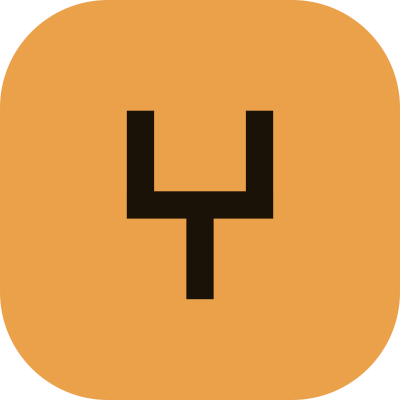

# kosa8 for Cursor

**[kosa8](https://kosa8.com): Secure infrastructure for AI agents.**

This plugin gives Cursor's agent a sealed Linux machine to work in. It connects
Cursor to the kosa8 Cloud MCP server, where every sandbox is a microVM with its
own kernel, so untrusted or generated code never runs on your computer.

## What it adds

- **MCP server `kosa8`** (`https://api.kosa8.com/mcp`, Streamable HTTP): 36
  tools to create sandboxes, run commands and Python, read and write files,
  open https previews of ports, snapshot, checkpoint, rewind and fork a running
  sandbox, and run CI pipelines. The full list:
  https://api.kosa8.com/.well-known/mcp/server-card.json
- **Skill `kosa8-sandbox`**: when to reach for a sandbox and how to use it
  safely (checkpoint before risky steps, delete what you made).
- **Rule `kosa8-untrusted-code`**: offer a sandbox for code nobody has reviewed.

## Setup

1. Sign up at https://app.kosa8.com and pick a plan.
2. Make an API key at https://app.kosa8.com/app#keys.
3. Install the plugin and set `KOSA8_API_KEY` to that key (Plugins → kosa8 →
   Configure). The key stays in Cursor's settings, not in this repository.

Then ask the agent, for example: "Clone this repo into a kosa8 sandbox and run
its tests there."

## Pricing

kosa8 is commercial software with no free tier: you need a kosa8 account on a
plan, from $29 a month. See https://kosa8.com/pricing/. The plugin files are
MIT licensed.

## Support

- Docs: https://docs.kosa8.com
- Email: contact@kosa8.com
- Issues: https://github.com/kosa8ai/kosa8-cursor-plugin/issues
